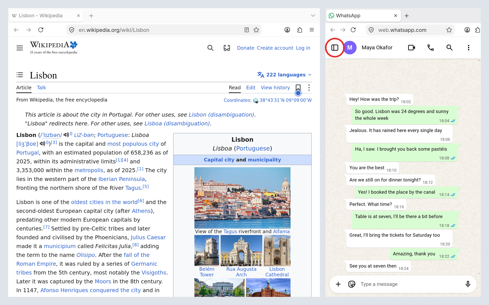
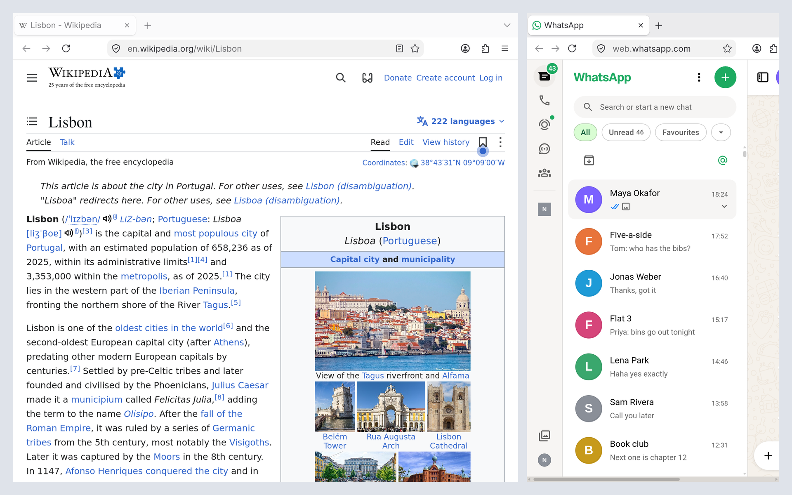
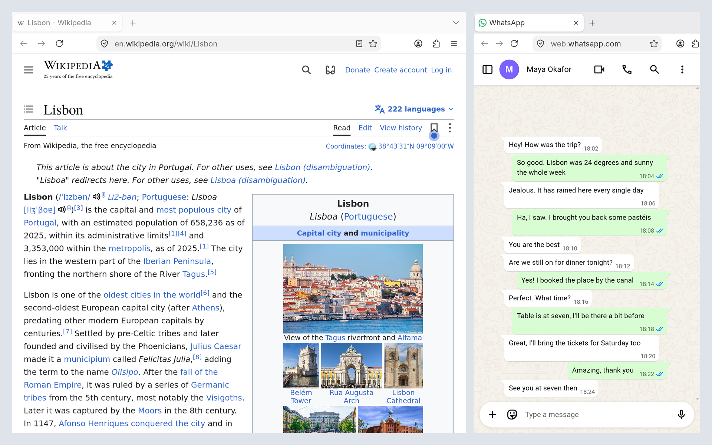

# Hide Sidebar for WhatsApp Web

Facebook, in its infinite wisdom, gives WhatsApp Web no way to collapse the chat list. This extension adds one button that does. It matters most in split screen, where WhatsApp gets a narrow window and the chat list takes all of it.

| Without | With |
| --- | --- |
|  |  |

Click the button in the chat header, or press `Alt+Shift+S`.

## Install

- **Firefox, Zen**: [Firefox Add-ons](https://addons.mozilla.org/firefox/addon/hide-sidebar-for-whatsapp-web/) (in review)
- **Chrome, Edge, Brave, Vivaldi**: [Chrome Web Store](https://chromewebstore.google.com/detail/cgcbklnncjeopadmnnkpjhpcloinagba) (in review)

Collects nothing, sends nothing. MIT. Not affiliated with WhatsApp or Meta.
