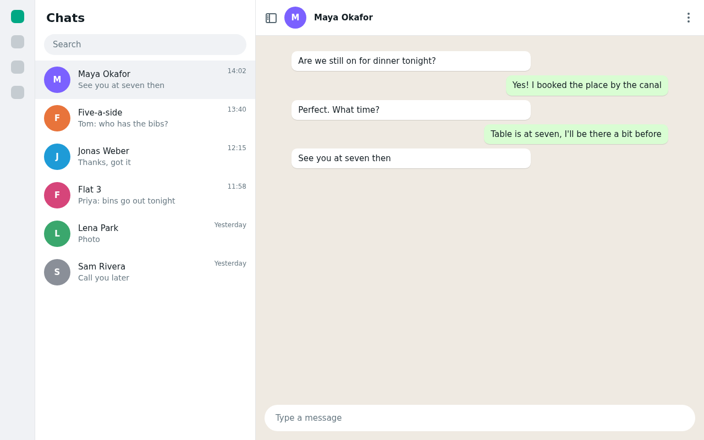

# Hide Sidebar for WhatsApp Web

One button hides the chat list on WhatsApp Web, so the chat you're in fills the window.

| Sidebar shown | Sidebar hidden |
| --- | --- |
|  |  |

## Why

- **Narrow or tiled window**: the chat list takes half the width. Now the conversation gets all of it.
- **Screen sharing**: nobody reads your chat list while you show one chat.
- **Focus**: one conversation, nothing else.

## Install

| Browser | |
| --- | --- |
| Firefox, Zen | [Firefox Add-ons](https://addons.mozilla.org/firefox/addon/hide-sidebar-for-whatsapp-web/) (in review) |
| Chrome, Chromium, Vivaldi, Edge, Brave | [Chrome Web Store](https://chromewebstore.google.com/detail/cgcbklnncjeopadmnnkpjhpcloinagba) (in review) |

Until the store pages are live, Chromium browsers can install by hand: download the `-chrome.zip` from [Releases](https://github.com/nazzacode/whatsapp-web-hide-sidebar/releases), unzip, then `chrome://extensions` → Developer mode → Load unpacked.

## Use

- Click the **button** at the left of the chat header, or press `Alt+Shift+S`.
- Your choice is remembered across reloads.
- With no chat open the sidebar always shows, so you never get a blank screen.
- Panels on the right (contact info, search) are left alone.

## Privacy

The extension collects nothing and sends nothing. It runs only on `web.whatsapp.com`, does not read your messages or contacts, makes no network requests, and stores one value (sidebar hidden or shown) in the page's local storage on your own device.

## How it works

WhatsApp's classes are hashed, so `sidebar.js` finds `#side`/`#main` by id, tags `#side`'s column and the nav rail (narrow full-height sibling) with `data-whs-*`, and `sidebar.css` hides by tag. Grid parents that don't reflow fall back to flex. The button is a fixed overlay outside `#app`, so React re-renders can't remove it.

## Develop

- Build `./build.sh` → `dist/whatsapp-web-hide-sidebar-firefox.xpi` (MV2) + `-chrome.zip` (MV3, manifest derived)
- Install into Zen `./build.sh --install` (Zen closed, unsigned)
- Test `test/run.sh` → headless Chromium over mock layouts (flex, outer rail, grid, drawer, no chat)
- Store assets `store/` (listing text, AMO metadata, `shots.sh` → screenshots from `demo.html`)
- Sign + submit to AMO: `web-ext sign --source-dir dist/firefox --channel listed --amo-metadata store/amo.json`

Not affiliated with WhatsApp or Meta. MIT.
