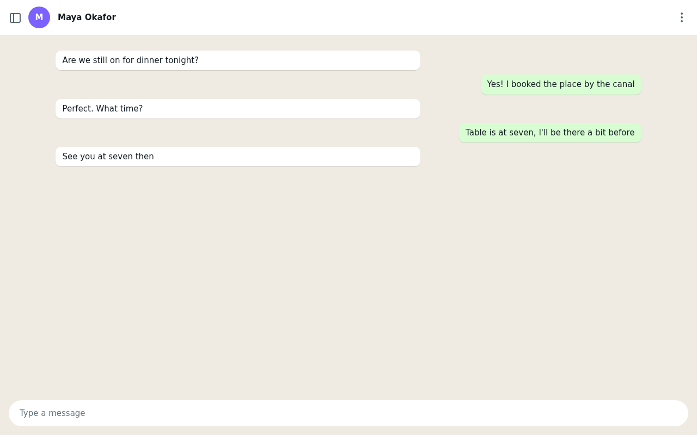

# Hide Sidebar for WhatsApp Web

Hide the WhatsApp Web sidebar (chat list + nav rail) so the open chat fills the window. Firefox, Zen and Chrome extension.

| Sidebar shown | Sidebar hidden |
| --- | --- |
|  |  |

- **Button** at the left of the chat header toggles it (remembered across reloads)
- `Alt+Shift+S` toggles too
- no chat open → sidebar always shown, button hidden
- right-hand drawers (contact info, search) are left alone
- no permissions beyond `web.whatsapp.com`, no data collected, no network requests

## Install

- **Firefox / Zen**: [addons.mozilla.org](https://addons.mozilla.org/firefox/addon/hide-sidebar-for-whatsapp-web/)
- **Chrome / Chromium / Vivaldi / Edge**: download the `-chrome.zip` from [Releases](https://github.com/nazzacode/whatsapp-web-hide-sidebar/releases), unzip, then `chrome://extensions` → Developer mode → Load unpacked

## Privacy

The extension collects nothing and sends nothing. It runs only on `web.whatsapp.com`, does not read your messages or contacts, makes no network requests, and stores one value (sidebar hidden or shown) in the page's local storage on your own device.

## How it works

WhatsApp's classes are hashed, so `sidebar.js` finds `#side`/`#main` by id, tags `#side`'s column and the nav rail (narrow full-height sibling) with `data-whs-*`, and `sidebar.css` hides by tag. Grid parents that don't reflow fall back to flex. The button is a fixed overlay outside `#app`, so React re-renders can't remove it.

## Develop

- Build `./build.sh` → `dist/whatsapp-web-hide-sidebar-firefox.xpi` (MV2) + `-chrome.zip` (MV3, manifest derived)
- Install into Zen `./build.sh --install` (Zen closed, unsigned)
- Test `test/run.sh` → headless Chromium over mock layouts (flex, outer rail, grid, drawer, no chat)
- Store assets `store/` (listing text, AMO metadata, `shots.sh` → screenshots from `demo.html`)
- Sign + submit to AMO: `web-ext sign --source-dir dist/firefox --channel listed --amo-metadata store/amo.json`

Not affiliated with WhatsApp or Meta. MIT.
